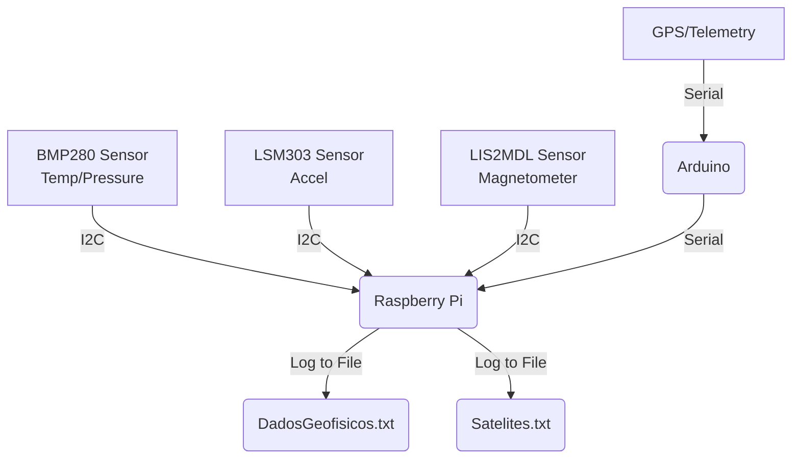

# 🌦️ IoT Weather Station


Project using an Arduino and Sensors connected to a Raspberry Pi to build a functional, telemetry-logging meteorological station. 

## 🗺️ Hardware & Data Flow Diagram



## 🛠️ Bill of Materials (BOM)

- **Microcontrollers:** Raspberry Pi 3/4, Arduino Uno/Mega
- **Sensors:**
  - BMP280 (Temperature & Pressure)
  - LSM303 (Accelerometer)
  - LIS2MDL (Magnetometer)
  - GPS Module (for Telemetry)
- **Cables:** Jumper wires (I2C, Serial, Power), USB Cable for Arduino -> Pi connection.

## 🔌 Wiring Overview

| Sensor / Module | Connection to Pi/Arduino | Protocol / Pins |
|-----------------|--------------------------|-----------------|
| BMP280          | Raspberry Pi             | I2C (SDA, SCL)  |
| LSM303          | Raspberry Pi             | I2C (SDA, SCL)  |
| LIS2MDL         | Raspberry Pi             | I2C (SDA, SCL)  |
| GPS             | Arduino                  | UART (RX, TX)   |
| Arduino         | Raspberry Pi             | USB Serial      |

## 🚀 Quickstart

1. **Clone the repository:**
   ```bash
   git clone https://github.com/your-username/meteostation.git
   cd meteostation
   ```

2. **Install dependencies:**
   ```bash
   pip install adafruit-blinka adafruit-circuitpython-bmp280 adafruit-circuitpython-lsm303-accel adafruit-circuitpython-lis2mdl pyserial pandas numpy matplotlib
   ```

3. **Run the weather station script:**
   ```bash
   python3 Raspberry_bmp_lsm.py
   ```

4. **Visualize data:**
   Lively recommend using [TelemetryViewer](http://www.farrellf.com/TelemetryViewer/) to visualize the data from afar!
